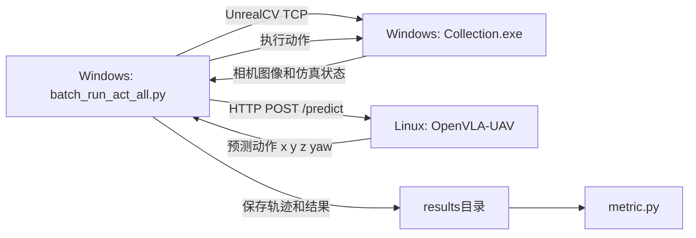
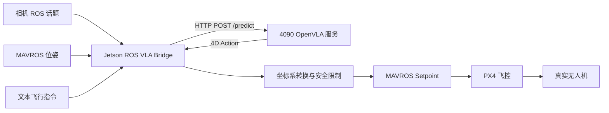

# UAV-Flow 跨平台仿真复现完整指南

> [!success] 已验证方案
> 本方案已经跑通完整闭环：
>
> **Windows 运行 Unreal 仿真与评估脚本，Linux GPU 服务器运行 OpenVLA-UAV 推理服务。**
>
> Windows 端通过 HTTP 请求 Linux 的 `/predict` 接口，Linux 返回动作，Windows 将动作送入 UnrealCV，并保存轨迹用于计算指标。

---

## 快速导航

- [一、最终部署方案](#一最终部署方案)
- [二、已验证的目录和参数](#二已验证的目录和参数)
- [三、需要准备的文件](#三需要准备的文件)
- [四、Linux 推理服务器配置](#四linux-推理服务器配置)
- [五、Windows 仿真端配置](#五windows-仿真端配置)
- [六、正式运行评估](#六正式运行评估)
- [七、计算评估指标](#七计算评估指标)
- [八、成功运行的判断标准](#八成功运行的判断标准)
- [九、复现过程中遇到的坑](#九复现过程中遇到的坑)
- [十、ROS 实机部署如何与 UAV-Flow 结合](#十ros-实机部署如何与-uav-flow-结合)
- [十一、再次复现时的最短流程](#十一再次复现时的最短流程)

---

# 一、最终部署方案

## 1.1 为什么要跨 Windows 和 Linux

官方提供的仿真环境文件是：

```text
Collection_WinNoEditor_0424_25.zip
```

其中：

- `WinNoEditor` 表示这是 Windows 版 Unreal Engine 打包程序。
- 仿真程序是 `.exe`，不能直接在 Linux 原生运行。
- OpenVLA-UAV 需要大显存 GPU，更适合运行在 Linux GPU 服务器。
- 因此采用“Windows 仿真 + Linux 推理”的跨机器架构。

## 1.2 系统架构



## 1.3 正确的数据流

实际工作流程是：

- `batch_run_act_all.py` 启动并控制 `Collection.exe`。
- Python 评估脚本通过 UnrealCV 获取图像和无人机状态。
- Python 评估脚本将图像、文本指令和状态发送到 Linux 的 `/predict`。
- Linux 上的 OpenVLA-UAV 返回动作。
- 评估脚本将动作送入 Unreal 仿真环境。
- 仿真器更新无人机位置并产生下一帧图像。
- 全部任务完成后，通过 `metric.py` 计算指标。

> [!important]
> 不是 `Collection.exe` 直接请求 OpenVLA 服务，而是 Windows 上的 `batch_run_act_all.py` 同时连接 UnrealCV 和 OpenVLA 服务。

---

# 二、已验证的目录和参数

## 2.1 Linux 服务器

| 项目 | 已验证值 |
|---|---|
| Linux 用户 | `howard` |
| GPU 推理环境 | `openvla` |
| 项目目录 | `~/UAV-Flow/OpenVLA-UAV` |
| 模型目录 | `/data/uavflow/OpenVLA-UAV checkpoint/OpenVLA-UAV` |
| 模型接口 | `/predict` |
| 推理端口 | `5007` |
| 当时使用的服务器 IP | `10.62.25.215` |
| 模型归一化配置 | `unnorm_key="sim"` |

> [!warning]
> `10.62.25.215` 是本次复现时的 IP，以后可能变化。每次启动前重新执行：
>
> ```bash
> hostname -I
> ```

## 2.2 Windows 仿真端

| 项目           | 已验证值                                                                         |
| ------------ | ---------------------------------------------------------------------------- |
| 评估代码目录       | `D:\UAV-Flow-Eval`                                                           |
| Unreal 仿真目录  | `D:\Collection_WinNoEditor_0424_25`                                          |
| 评估环境         | `unrealcv`                                                                   |
| Python 版本    | `3.11`                                                                       |
| 配置文件         | `D:\UAV-Flow-Eval\gym_unrealcv\envs\setting\Track\DowntownWest.json`         |
| Unreal 可执行文件 | `D:\Collection_WinNoEditor_0424_25\Collection\Binaries\Win64\Collection.exe` |

---

# 三、需要准备的文件

## 3.1 必需文件

- `OpenVLA-UAV` 项目代码。
- `UAV-Flow-Eval` 评估代码。
- OpenVLA-UAV 官方检查点。
- `Collection_WinNoEditor_0424_25.zip`。
- Windows 电脑。
- Linux GPU 服务器。
- Windows 与 Linux 之间可用的网络连接。

## 3.2 本次不需要重新训练

本指南主线是：

```text
下载官方模型权重
    ↓
启动 Linux 推理服务
    ↓
Windows 运行 Unreal 仿真
    ↓
执行闭环评估
    ↓
计算 nDTW 等指标
```

因此不需要执行：

```bash
python dataset_tools/prepare_data.py
bash vla-scripts/finetune_uav.sh
```

只有重新微调模型时才需要准备训练数据和运行训练脚本。

## 3.3 检查模型目录

Linux 上执行：

```bash
ls -lh "/data/uavflow/OpenVLA-UAV checkpoint/OpenVLA-UAV"
```

该目录中应包含类似文件：

```text
config.json
generation_config.json
model-00001-of-00004.safetensors
model-00002-of-00004.safetensors
model-00003-of-00004.safetensors
model-00004-of-00004.safetensors
model.safetensors.index.json
preprocessor_config.json
```

> [!danger]
> `model_path` 必须指向真正包含 `config.json` 和 `.safetensors` 的目录，不能只指向外层文件夹。

---

# 四、Linux 推理服务器配置

## 4.1 激活环境

```bash
conda activate openvla
cd ~/UAV-Flow/OpenVLA-UAV
```

确认当前 Python 和 pip 都来自 `openvla`：

```bash
which python
python -m pip --version
```

## 4.2 安装兼容依赖

项目对 `transformers` 和 `timm` 版本比较敏感。推荐固定版本，不要直接安装不受控的最新版。

```bash
python -m pip install flask accelerate einops sentencepiece
python -m pip install "transformers==4.40.1"
python -m pip install "timm>=0.9.10,<1.0.0"
```

本次实际使用 `transformers==4.41.2` 也成功运行，但模型日志建议使用 `4.40.1`。全新复现优先使用：

```bash
python -m pip install "transformers==4.40.1"
```

验证关键接口：

```bash
python -c "from transformers import AutoModelForVision2Seq; print('import successful')"
```

验证版本：

```bash
python -c "import transformers,timm; print('transformers:',transformers.__version__); print('timm:',timm.__version__)"
```

预期：

```text
transformers: 4.40.1
timm: 0.9.x
```

## 4.3 配置模型路径

编辑：

```text
~/UAV-Flow/OpenVLA-UAV/vla-scripts/openvla_act.py
```

将配置改为：

```python
cfg = {
    "gpu_id": 0,
    "model_path": "/data/uavflow/OpenVLA-UAV checkpoint/OpenVLA-UAV",
    "http_port": 5007,
    "unnorm_key": "sim",
    "do_sample": False,
}
```

## 4.4 允许 Windows 访问服务

检查脚本底部的服务启动代码，必须监听全部网卡：

```python
agent.run(host="0.0.0.0", port=cfg["http_port"])
```

如果使用的是 Flask 的 `app` 对象，则应类似：

```python
app.run(host="0.0.0.0", port=cfg["http_port"])
```

不能只监听：

```python
host="127.0.0.1"
```

否则只有 Linux 本机能够访问。

## 4.5 检查 GPU 显存

```bash
nvidia-smi
```

建议确保有约 20GB 以上可用显存。若显存被其他程序占用，先查找进程：

```bash
nvidia-smi
```

确认无用后再终止对应 PID：

```bash
kill <PID>
```

必要时：

```bash
kill -9 <PID>
```

## 4.6 启动推理服务

```bash
conda activate openvla
cd ~/UAV-Flow/OpenVLA-UAV
python vla-scripts/openvla_act.py
```

成功时应看到：

```text
Loading checkpoint shards: 100%
VLA model type: OpenVLAForActionPrediction
Starting HTTP server on port 5007
Running on all addresses (0.0.0.0)
Running on http://127.0.0.1:5007
Running on http://10.62.25.215:5007
```

> [!important]
> 启动后不要关闭这个终端。关闭终端会停止模型服务。

## 4.7 Flash Attention 警告是否需要处理

可能出现：

```text
You are attempting to use Flash Attention 2.0 with a model not initialized on GPU
```

或：

```text
without specifying a torch dtype
```

只要后面成功出现：

```text
Loading checkpoint shards: 100%
Starting HTTP server on port 5007
```

说明模型已经正常加载，这些警告暂时可以忽略。

如果需要显式指定数据类型，可在模型加载代码中使用：

```python
self.model = AutoModelForVision2Seq.from_pretrained(
    self.model_path,
    attn_implementation="flash_attention_2",
    torch_dtype=torch.bfloat16,
    low_cpu_mem_usage=True,
    trust_remote_code=True,
    device_map={"": self.device},
)
```

不要在已经成功运行的情况下随意修改模型加载代码。

---

# 五、Windows 仿真端配置

## 5.1 安装 Unreal 前置运行库

如果运行 `Collection.exe` 时提示缺少 DirectX 或运行库，执行仿真包中的：

```text
UE4PrereqSetup_x64.exe
```

安装内容通常包括：

- DirectX Runtime。
- Visual C++ Redistributable。
- Unreal Engine 4 所需组件。

安装完成后可以手动测试：

```powershell
cd D:\Collection_WinNoEditor_0424_25
.\Collection.exe -ResX=1280 -ResY=720 -windowed
```

手动测试成功后关闭程序，正式评估时让 `batch_run_act_all.py` 自动启动，避免 UnrealCV 端口冲突。

## 5.2 创建 Windows Conda 环境

打开 Anaconda PowerShell Prompt：

```powershell
cd D:\UAV-Flow-Eval

conda create -n unrealcv python=3.11 -y
conda activate unrealcv

python -m pip install -e .
```

安装旧项目兼容依赖：

```powershell
python -m pip install "setuptools<70"
python -m pip install "numpy<2"
```

推荐固定：

```powershell
python -m pip install "setuptools<70" "numpy==1.26.4"
```

## 5.3 配置 Unreal 可执行文件路径

编辑：

```text
D:\UAV-Flow-Eval\gym_unrealcv\envs\setting\Track\DowntownWest.json
```

将 `env_bin_win` 设置为包含 `Binaries\Win64` 的深层路径：

```json
"env_bin_win": "D:\\Collection_WinNoEditor_0424_25\\Collection\\Binaries\\Win64\\Collection.exe"
```

不要使用：

```json
"env_bin_win": "D:\\Collection_WinNoEditor_0424_25\\Collection.exe"
```

原因是 `gym_unrealcv` 的启动器会解析 `Binaries` 目录。虽然根目录的 `Collection.exe` 可以手动启动，但评估启动器可能拒绝该路径。

## 5.4 为评估脚本添加服务器 IP 参数

原脚本只支持：

```text
--server_port
```

不支持：

```text
--server_ip
```

编辑：

```text
D:\UAV-Flow-Eval\batch_run_act_all.py
```

找到参数解析部分，在 `server_port` 参数附近添加：

```python
parser.add_argument(
    "--server_ip",
    default="127.0.0.1",
    help="OpenVLA inference server IP address",
)
```

找到原来的：

```python
server_url = f"http://127.0.0.1:{args.server_port}/predict"
```

修改为：

```python
server_url = f"http://{args.server_ip}:{args.server_port}/predict"
```

保存后即可使用：

```powershell
python batch_run_act_all.py --server_ip 10.62.25.215 --server_port 5007
```

如果不想添加参数，也可以直接硬编码：

```python
server_url = f"http://10.62.25.215:{args.server_port}/predict"
```

但推荐添加 `--server_ip`，以后服务器 IP 改变时无需再次修改源码。

## 5.5 修复 NumPy 标量转换错误

如果出现：

```text
TypeError: only length-1 arrays can be converted to Python scalars
```

或者错误位置在：

```text
gym_unrealcv\envs\track.py
get_tracker_init_point
```

编辑：

```text
D:\UAV-Flow-Eval\gym_unrealcv\envs\track.py
```

将 `get_tracker_init_point` 替换为：

```python
def get_tracker_init_point(self, target_pos, distance, direction=None):
    distance = float(np.asarray(distance).reshape(-1)[0])

    if direction is None:
        direction = float(2 * np.pi * np.random.sample())
    else:
        direction = float(np.asarray(direction).reshape(-1)[0])
        direction = direction % (2 * np.pi)

    dx = float(distance * np.cos(direction))
    dy = float(distance * np.sin(direction))

    x = dx + target_pos[0]
    y = dy + target_pos[1]
    z = target_pos[2]

    cam_pos_exp = [x, y, z]
    yaw = float(direction / np.pi * 180 - 180)

    return [cam_pos_exp, yaw]
```

根本原因是原代码使用：

```python
np.random.sample(1)
```

它返回一个一维数组，而不是普通浮点数。新版 NumPy 不再允许直接将这类数组隐式转换为 `float`。

## 5.6 测试 Windows 到 Linux 的端口连接

Windows PowerShell 执行：

```powershell
Test-NetConnection -ComputerName 10.62.25.215 -Port 5007
```

成功时应显示：

```text
TcpTestSucceeded : True
```

如果失败，在 Linux 上检查服务：

```bash
ss -lntp | grep 5007
```

正常应监听：

```text
0.0.0.0:5007
```

如果 Linux 使用 UFW：

```bash
sudo ufw allow 5007/tcp
```

查看状态：

```bash
sudo ufw status
```

## 5.7 Windows 与 Linux 不在同一网络时

如果 Windows 无法直接连接 `10.62.25.215:5007`，但可以 SSH 登录 Linux，可以使用 SSH 隧道。

Windows 打开一个单独的 PowerShell：

```powershell
ssh -N -L 5007:127.0.0.1:5007 howard@<Linux服务器SSH地址>
```

保持该窗口运行，然后评估脚本连接 Windows 本地端口：

```powershell
python batch_run_act_all.py --server_ip 127.0.0.1 --server_port 5007
```

数据会经过：

```text
Windows 127.0.0.1:5007
    ↓ SSH 隧道
Linux 127.0.0.1:5007
```

---

# 六、正式运行评估

## 6.1 Terminal 1：Linux 启动模型

```bash
conda activate openvla
cd ~/UAV-Flow/OpenVLA-UAV
python vla-scripts/openvla_act.py
```

保持运行。

## 6.2 Terminal 2：Windows 启动评估

```powershell
conda activate unrealcv
cd D:\UAV-Flow-Eval

python batch_run_act_all.py --server_ip 10.62.25.215 --server_port 5007
```

如果采用 SSH 隧道：

```powershell
python batch_run_act_all.py --server_ip 127.0.0.1 --server_port 5007
```

## 6.3 程序运行过程

评估脚本将自动执行：

```text
读取测试任务
    ↓
启动 Collection.exe
    ↓
连接 UnrealCV
    ↓
初始化无人机位置
    ↓
获取图像和状态
    ↓
请求 Linux /predict
    ↓
接收 OpenVLA 动作
    ↓
控制仿真无人机
    ↓
保存轨迹和结果
    ↓
切换下一个任务
```

本次评估包含约 273 个测试任务，运行时间取决于：

- GPU 推理速度。
- Windows 渲染速度。
- 网络延迟。
- 每个任务是否提前结束。
- 是否发生碰撞或停滞。

---

# 七、计算评估指标

等待全部任务运行完成后，在 Windows 执行：

```powershell
conda activate unrealcv
cd D:\UAV-Flow-Eval
python metric.py
```

结果通常包含：

- nDTW。
- Success Rate。
- 轨迹相似度。
- 任务成功统计。
- 碰撞或停滞情况。

评估结果通常保存在类似目录：

```text
D:\UAV-Flow-Eval\results\UnrealTrack-DowntownWest-ContinuousColor-v0\openvla
```

建议完成后立即备份：

```text
results/
日志文件
运行时使用的配置文件
openvla_act.py
batch_run_act_all.py
track.py
```

---

# 八、成功运行的判断标准

## 8.1 Linux 端

应持续出现：

```text
POST /predict HTTP/1.1" 200
```

并输出类似：

```text
Current State: ...
Raw predicted action: ...
```

本次实测单步推理时间约：

```text
0.11 秒
```

约等于 9 FPS，说明模型推理和网络链路正常。

## 8.2 Windows 端

应出现：

```text
Got connection confirm: b'connected to Collection'
```

随后持续打印：

```text
Task ...
Episode ...
Action ...
Saving result ...
```

同时：

- Unreal 窗口中的画面会发生变化。
- 无人机会自动移动。
- `results` 目录不断产生文件。
- Linux 端不断收到 `/predict` 请求。

## 8.3 完整复现成功标准

满足以下条件即说明仿真闭环已打通：

- [ ] Unreal 环境能正常启动。
- [ ] Windows 能连接 UnrealCV。
- [ ] Windows 能访问 Linux 的 5007 端口。
- [ ] Linux 能成功加载 OpenVLA-UAV 权重。
- [ ] `/predict` 请求返回 HTTP 200。
- [ ] Windows 能收到动作并控制无人机。
- [ ] 轨迹与结果文件能正常保存。
- [ ] `metric.py` 能输出评估指标。

---

# 九、复现过程中遇到的坑

## 9.1 Windows 仿真包不能在 Linux 运行

**现象：**

```text
Collection_WinNoEditor_0424_25
Collection.exe
Win64
```

**原因：**

这是 Windows 版 Unreal Engine 打包程序。

**解决：**

- Windows 运行 Unreal 和评估脚本。
- Linux GPU 服务器运行 OpenVLA。
- 两端通过 HTTP 通信。

---

## 9.2 缎少 Flask

**报错：**

```text
ModuleNotFoundError: No module named 'flask'
```

**解决：**

```bash
conda activate openvla
python -m pip install flask
```

---

## 9.3 找不到 AutoModelForVision2Seq

**报错：**

```text
ImportError: cannot import name 'AutoModelForVision2Seq'
```

**原因：**

- `transformers` 版本不兼容。
- pip 与当前 Conda 环境不一致。
- 安装残留或依赖冲突。

**解决：**

```bash
conda activate openvla

python -m pip uninstall -y transformers
python -m pip install --no-cache-dir "transformers==4.40.1"
```

验证：

```bash
python -c "from transformers import AutoModelForVision2Seq; print('import successful')"
```

---

## 9.4 timm 版本过高

**报错或提示：**

```text
Expected 0.9.10 <= timm < 1.0.0
```

**解决：**

```bash
python -m pip install "timm>=0.9.10,<1.0.0"
```

不要直接使用 `timm 1.x`。

---

## 9.5 Bash 中感叹号报错

**报错：**

```text
bash: !': event not found
```

**原因：**

Bash 会把双引号中的 `!` 当作历史命令展开。

**解决：**

不要在测试输出字符串中使用感叹号：

```bash
python -c "from transformers import AutoModelForVision2Seq; print('Import successful')"
```

---

## 9.6 模型路径填错

**错误写法：**

```python
"model_path": "/data/uavflow/OpenVLA-UAV checkpoint"
```

**正确写法：**

```python
"model_path": "/data/uavflow/OpenVLA-UAV checkpoint/OpenVLA-UAV"
```

判断方法：该目录必须直接包含 `config.json` 和 `.safetensors`。

---

## 9.7 Flask 只能本机访问

**现象：**

Linux 本机能访问，Windows 无法连接。

**原因：**

服务只监听：

```text
127.0.0.1
```

**解决：**

```python
agent.run(host="0.0.0.0", port=5007)
```

---

## 9.8 使用了错误的 Linux IP

Linux 可能显示：

```text
10.62.25.215
172.17.0.1
```

其中：

- `10.62.25.215` 是实际局域网 IP。
- `172.17.0.1` 通常是 Docker 虚拟网卡。

Windows 应连接：

```text
10.62.25.215
```

不要连接：

```text
172.17.0.1
```

---

## 9.9 batch_run_act_all.py 不支持 server_ip

**报错：**

```text
unrecognized arguments: --server_ip
```

**原因：**

原脚本只定义了 `--server_port`。

**解决：**

添加：

```python
parser.add_argument("--server_ip", default="127.0.0.1")
```

修改 URL：

```python
server_url = f"http://{args.server_ip}:{args.server_port}/predict"
```

---

## 9.10 pkg_resources 缺失

**报错：**

```text
ModuleNotFoundError: No module named 'pkg_resources'
```

**原因：**

旧版 Gym 依赖 `pkg_resources`，新版 `setuptools` 与旧项目兼容性较差。

**解决：**

```powershell
python -m pip install "setuptools<70"
```

---

## 9.11 Unreal 路径必须包含 Binaries

**报错表现：**

启动器解析可执行文件路径失败，即使根目录 `Collection.exe` 能手动打开。

**错误路径：**

```text
D:\Collection_WinNoEditor_0424_25\Collection.exe
```

**正确路径：**

```text
D:\Collection_WinNoEditor_0424_25\Collection\Binaries\Win64\Collection.exe
```

JSON 写法：

```json
"env_bin_win": "D:\\Collection_WinNoEditor_0424_25\\Collection\\Binaries\\Win64\\Collection.exe"
```

---

## 9.12 NumPy 数组无法转换为 float

**报错：**

```text
TypeError: only length-1 arrays can be converted to Python scalars
```

**原因：**

原代码中的：

```python
np.random.sample(1)
```

返回一维数组。

**解决：**

改为：

```python
np.random.sample()
```

并显式转为标量：

```python
direction = float(2 * np.pi * np.random.sample())
```

推荐直接使用本文给出的完整 `get_tracker_init_point()` 修复代码。

---

## 9.13 /reset 返回 404

**日志：**

```text
POST /reset HTTP/1.1" 404
```

**原因：**

Windows 客户端在新任务开始时尝试重置模型，但 Linux 服务没有注册 `/reset` 路由。

如果当前 OpenVLA 是单帧无状态推理，该 404 通常不影响结果。

如需消除日志，可在 Flask 服务中加入：

```python
@app.route("/reset", methods=["POST"])
def reset():
    return {"status": "success"}, 200
```

如果脚本中的 Flask 对象不叫 `app`，需要换成实际对象名。

---

## 9.14 模型连续输出相同动作

**现象：**

```text
Raw predicted action: [[0.1008 0.1270 0.0 0.0]]
```

连续多步几乎不变，Windows 提示：

```text
Detected x,y,z,yaw continuous 10 steps change is very small
automatically end task
```

**解释：**

- 这不是网络连接失败。
- 说明模型确实返回了动作。
- 评估脚本检测到无人机长期停滞，因此提前结束任务。
- 可能影响最终成功率和 nDTW，但不代表复现流水线失败。

检查重点：

- `unnorm_key` 是否正确。
- 模型检查点是否正确。
- 输入图像预处理是否与官方一致。
- Prompt 是否正常传入。
- 动作是否在客户端再次错误缩放。
- 是否加载了仿真评估对应的权重。

---

## 9.15 DirectX 或 Visual C++ 缺失

**现象：**

启动 `Collection.exe` 时弹窗提示缺少运行库。

**解决：**

运行：

```text
UE4PrereqSetup_x64.exe
```

若仍失败，安装：

- DirectX End-User Runtime。
- Microsoft Visual C++ Redistributable 2015–2022 x64。

---

## 9.16 手动启动 Unreal 后评估脚本连接失败

**原因：**

手动启动的 `Collection.exe` 可能占用 UnrealCV 端口，导致评估脚本无法重新拉起实例。

**解决：**

- 手动启动仅用于测试。
- 正式评估前关闭所有 `Collection.exe`。
- 在任务管理器中确认没有残留进程。
- 再运行 `batch_run_act_all.py`。

---

# 十、ROS 实机部署如何与 UAV-Flow 结合

## 10.1 核心思路

仿真阶段使用：

```text
Collection.exe
+ gym_unrealcv
+ batch_run_act_all.py
```

实机阶段将它们替换为：

```text
真实摄像头
+ Jetson Orin NX
+ ROS/MAVROS
+ PX4
+ vla_bridge_node
```

Linux 上的 OpenVLA 推理服务器可以继续使用。



## 10.2 哪些部分可以直接复用

| 仿真部分                         | 实机是否复用             |
| ---------------------------- | ------------------ |
| OpenVLA-UAV 模型权重             | 复用                 |
| `openvla_act.py` 推理服务        | 基本复用               |
| `/predict` HTTP 接口           | 复用                 |
| 图像和文本预处理                     | 必须保持一致             |
| `batch_run_act_all.py` 的请求格式 | 需要复制到 ROS 节点       |
| UnrealCV                     | 不再使用               |
| `Collection.exe`             | 不再使用               |
| 仿真动作执行                       | 替换为 MAVROS/PX4 控制  |
| `metric.py`                  | 替换为 rosbag 与实机轨迹评估 |

## 10.3 首先确认 `/predict` 的真实协议

不要凭空设计新的 JSON 格式。

在 Windows 项目中搜索：

```powershell
cd D:\UAV-Flow-Eval

Select-String `
  -Path .\batch_run_act_all.py `
  -Pattern "requests.post|server_url|predict|base64" `
  -Context 5,15
```

重点找到：

```python
requests.post(...)
```

记录以下内容：

- 请求 URL。
- JSON 字段名称。
- 图像编码方式。
- Prompt 字段名称。
- State 字段顺序。
- Action 返回字段名称。
- Action 数值的维度。
- 超时参数。
- 是否使用 Base64。
- 是否在客户端进行动作缩放。

ROS 节点必须复制相同的数据格式，不能自己随意命名字段。

## 10.4 ROS 节点需要订阅的话题

根据实际无人机话题修改。

| 数据 | 推荐话题 |
|---|---|
| RGB 图像 | `/camera/color/image_raw` |
| 无人机位姿 | `/mavros/local_position/pose` |
| 无人机里程计 | `/mavros/local_position/odom` |
| 飞控状态 | `/mavros/state` |
| 文本指令 | `/vla/instruction` |
| 手动急停 | `/vla/emergency_stop` |

## 10.5 ROS 节点需要发布的内容

初期推荐使用位置目标，安全性高于直接速度控制：

```text
/mavros/setpoint_position/local
```

成熟后再考虑：

```text
/mavros/setpoint_velocity/cmd_vel_unstamped
```

或：

```text
/mavros/setpoint_raw/local
```

> [!danger]
> 模型返回的四个数字不能直接发送给 PX4。必须先确认它们到底表示：
>
> - 绝对位置；
> - 相对位移；
> - 速度；
> - 归一化动作；
> - 仿真坐标系中的目标；
> - 相机坐标系中的目标。

## 10.6 确认动作语义

在 `batch_run_act_all.py` 中搜索：

```powershell
Select-String `
  -Path .\batch_run_act_all.py `
  -Pattern "env.step|predicted_action|action" `
  -Context 5,15
```

继续查看 `gym_unrealcv` 内部如何使用该动作。

必须确认：

```text
模型输出
    ↓
是否反归一化
    ↓
是否作为位置增量
    ↓
是否转换坐标系
    ↓
如何传入 env.step()
```

在没有确认之前，不要假设：

```text
[x, y, z, yaw] = [vx, vy, vz, yaw_rate]
```

## 10.7 仿真与实机的 unnorm_key

仿真评估使用：

```python
"unnorm_key": "sim"
```

实机部署不能直接照搬。

必须检查模型配置中有哪些归一化统计键，例如：

```text
sim
real
uav_flow
```

实机应使用真实数据对应的归一化统计。否则可能出现：

- 动作幅度过小。
- 动作幅度过大。
- 模型持续输出固定动作。
- 无人机运动方向错误。

如果模型只提供 `sim` 统计，需要重新确认该检查点是否适合直接实机部署。

## 10.8 创建 ROS1 功能包

在 Jetson Orin NX 上执行：

```bash
cd ~/catkin_ws/src

catkin_create_pkg uavflow_bridge \
  rospy \
  sensor_msgs \
  geometry_msgs \
  nav_msgs \
  std_msgs \
  mavros_msgs \
  cv_bridge \
  tf2_ros
```

创建脚本目录：

```bash
cd ~/catkin_ws/src/uavflow_bridge
mkdir -p scripts launch config
touch scripts/vla_bridge_node.py
chmod +x scripts/vla_bridge_node.py
```

安装 Python 依赖：

```bash
python3 -m pip install requests opencv-python
```

编译：

```bash
cd ~/catkin_ws
catkin_make
source devel/setup.bash
```

## 10.9 ROS Bridge 节点职责

`vla_bridge_node.py` 需要完成：

- 订阅最新相机图像。
- 订阅 MAVROS 位姿或里程计。
- 获取当前文本指令。
- 按官方评估代码相同方式处理图像。
- 组装与 `batch_run_act_all.py` 完全一致的请求。
- 请求 GPU 服务器 `/predict`。
- 解析返回的 Action。
- 完成坐标系转换。
- 限制最大位移、速度和偏航变化。
- 将目标发送给 MAVROS。
- 推理超时时悬停。
- 记录每次输入、输出和时间戳。

核心结构：

```python
#!/usr/bin/env python3

import threading
import requests
import rospy

class VLABridge:
    def __init__(self):
        self.server_url = rospy.get_param(
            "~server_url",
            "http://10.62.25.215:5007/predict",
        )

        self.latest_image = None
        self.latest_pose = None
        self.instruction = ""
        self.latest_safe_setpoint = None
        self.inference_running = False
        self.lock = threading.Lock()

        # 在这里创建图像、位姿、指令订阅器
        # 在这里创建 MAVROS 目标发布器

        rospy.Timer(
            rospy.Duration(0.2),
            self.inference_timer,
        )

        rospy.Timer(
            rospy.Duration(1.0 / 30.0),
            self.publish_setpoint_timer,
        )

    def inference_timer(self, event):
        if self.inference_running:
            return

        if self.latest_image is None or self.latest_pose is None:
            return

        self.inference_running = True

        try:
            payload = self.build_official_compatible_payload()

            response = requests.post(
                self.server_url,
                json=payload,
                timeout=0.8,
            )
            response.raise_for_status()

            action = self.parse_official_response(response.json())
            setpoint = self.convert_action_to_enu_setpoint(action)
            setpoint = self.apply_safety_limits(setpoint)

            with self.lock:
                self.latest_safe_setpoint = setpoint

        except Exception as exc:
            rospy.logwarn_throttle(
                1.0,
                "VLA inference failed: %s" % exc,
            )
            self.set_hover_target()

        finally:
            self.inference_running = False

    def publish_setpoint_timer(self, event):
        with self.lock:
            setpoint = self.latest_safe_setpoint

        if setpoint is not None:
            self.publish_to_mavros(setpoint)

    def build_official_compatible_payload(self):
        raise NotImplementedError

    def parse_official_response(self, response_json):
        raise NotImplementedError

    def convert_action_to_enu_setpoint(self, action):
        raise NotImplementedError

    def apply_safety_limits(self, setpoint):
        return setpoint

    def set_hover_target(self):
        pass

    def publish_to_mavros(self, setpoint):
        pass

if __name__ == "__main__":
    rospy.init_node("vla_bridge_node")
    VLABridge()
    rospy.spin()
```

其中以下函数必须根据官方评估代码实现：

```python
build_official_compatible_payload()
parse_official_response()
convert_action_to_enu_setpoint()
```

## 10.10 为什么推理和控制发布要分开

OpenVLA 推理可能只有约 5～10Hz，但 PX4 Offboard 模式要求持续收到控制目标。

因此建议：

```text
模型推理线程：2～10Hz
MAVROS Setpoint 发布：20～50Hz
```

不能只在模型返回时才发布一次控制指令，否则 PX4 可能退出 Offboard 模式。

推荐结构：

```text
推理线程
    ↓ 更新最新目标点
安全缓存
    ↓ 反复读取
30Hz Setpoint 发布线程
```

## 10.11 坐标系转换

必须确认以下坐标系：

- 模型输出坐标系。
- Unreal 仿真坐标系。
- 相机坐标系。
- ROS ENU 坐标系。
- PX4 NED 坐标系。
- 无人机机体系。

MAVROS 的本地位置接口通常使用 ENU，但 PX4 内部通常使用 NED。优先使用：

- `tf2_ros`
- `geometry_msgs/TransformStamped`
- 静态外参
- 实际标定结果

不要只通过交换 `x/y/z` 猜测坐标关系。

至少进行以下测试：

- 向前指令是否真的向前。
- 向左指令是否真的向左。
- 正高度指令是否向上。
- 正偏航是否符合预期方向。
- 机头旋转后，相对动作是否正确转换。

## 10.12 必须加入的安全机制

ROS 实机节点至少加入：

- 推理超时后悬停。
- HTTP 请求超时。
- 最大速度限制。
- 最大单步位移限制。
- 最大偏航变化限制。
- 高度上下限。
- 飞行区域限制。
- 图像过期检测。
- 位姿过期检测。
- 网络断开检测。
- RC 遥控器人工接管。
- 急停话题。
- 不允许模型直接解锁。
- 不允许模型直接自动起飞。
- rosbag 全程记录。

建议初始限制：

```text
水平速度 ≤ 0.3 m/s
垂直速度 ≤ 0.2 m/s
单步位置变化 ≤ 0.2 m
偏航变化 ≤ 5°
推理超时 ≥ 0.8 s 时悬停
```

具体数值根据机型和场地调整。

## 10.13 ROS 实机验证顺序

严格按照以下顺序测试：

### 阶段 1：只测试网络

Jetson 请求 Linux 推理服务，但不连接飞控。

验证：

- 图像上传正常。
- `/predict` 返回 200。
- 动作格式正确。
- 推理时延稳定。

### 阶段 2：只打印动作

ROS 节点接收模型动作，但不发布 MAVROS。

验证：

- 动作范围合理。
- 不持续出现 NaN。
- 不会突然产生超大值。
- 文本指令改变后动作会变化。

### 阶段 3：地面不装桨测试

连接 PX4，但拆除螺旋桨。

验证：

- MAVROS 目标方向正确。
- Offboard 模式稳定。
- 断网后进入悬停或安全模式。
- 人工遥控可接管。

### 阶段 4：仿真飞控测试

优先使用 PX4 SITL 或 Gazebo 测试 ROS Bridge。

### 阶段 5：系留低空测试

- 限高。
- 限速。
- 空旷场地。
- 人工遥控器随时接管。
- 一次只执行短距离动作。

### 阶段 6：短距离闭环测试

逐步测试：

```text
前进
后退
左移
右移
升高
降低
偏航
简单目标导航
复杂语言指令
```

---

# 十一、再次复现时的最短流程

## 11.1 Linux

```bash
conda activate openvla
cd ~/UAV-Flow/OpenVLA-UAV

hostname -I
nvidia-smi

python vla-scripts/openvla_act.py
```

确认：

```text
Running on http://<Linux-IP>:5007
```

## 11.2 Windows 网络测试

```powershell
Test-NetConnection -ComputerName <Linux-IP> -Port 5007
```

必须显示：

```text
TcpTestSucceeded : True
```

## 11.3 Windows 启动评估

```powershell
conda activate unrealcv
cd D:\UAV-Flow-Eval

python batch_run_act_all.py `
  --server_ip <Linux-IP> `
  --server_port 5007
```

例如：

```powershell
python batch_run_act_all.py `
  --server_ip 10.62.25.215 `
  --server_port 5007
```

## 11.4 等待任务完成

检查：

- Linux 持续出现 `/predict 200`。
- Windows 显示 Task/Episode 进度。
- Unreal 中的无人机正在移动。
- `results` 目录不断产生文件。

## 11.5 计算指标

```powershell
cd D:\UAV-Flow-Eval
python metric.py
```

---

# 十二、本次实际修改记录

| 文件 | 修改内容 |
|---|---|
| `openvla_act.py` | 设置正确的模型绝对路径 |
| `openvla_act.py` | 服务监听 `0.0.0.0:5007` |
| `batch_run_act_all.py` | 添加 `--server_ip` 参数 |
| `batch_run_act_all.py` | 将模型 URL 改为可配置 IP 的 `/predict` |
| `DowntownWest.json` | 设置 Windows 深层 Unreal 可执行文件路径 |
| `track.py` | 修复 NumPy 数组转 float 报错 |
| Linux `openvla` 环境 | 安装 Flask、Transformers、timm 等依赖 |
| Windows `unrealcv` 环境 | 降级 `setuptools`，限制 NumPy 版本 |
| Windows 系统 | 安装 UE4 Prerequisites |

---

# 十三、最终结论

本次已经完成的不是简单的“模型成功加载”，而是完整的 UAV-Flow 闭环评估复现：

```text
Unreal 场景启动
    ↓
UnrealCV 获取图像和状态
    ↓
Windows 评估脚本发送请求
    ↓
Linux OpenVLA-UAV 推理
    ↓
返回 4D 动作
    ↓
仿真无人机执行动作
    ↓
生成闭环轨迹
    ↓
保存结果
    ↓
计算评估指标
```

后续实机部署时，核心模型服务和 HTTP 协议继续复用，只需将：

```text
UnrealCV + Collection.exe
```

替换为：

```text
Jetson Orin NX + ROS + MAVROS + PX4
```

最关键的工作不是重新训练模型，而是：

- 完全复刻官方请求与图像预处理格式。
- 确认模型动作的真实含义。
- 正确完成仿真坐标系到 ROS/PX4 坐标系的转换。
- 增加限速、超时悬停、人工接管等实机安全机制。