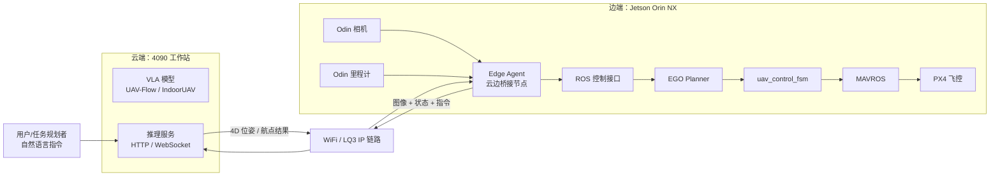
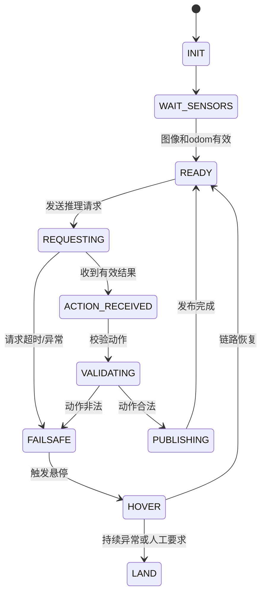
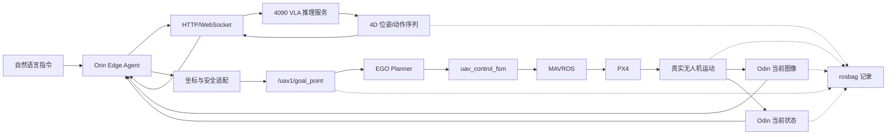

---
title: 云边协同无人机视觉语言导航项目计划书
date: 2026-09-06
tags:
  - 无人机
  - 云边协同
  - Jetson-Orin-NX
  - OpenVLA
  - IndoorUAV
  - ROS
  - PX4
  - 项目计划
status: 方案设计
---

# 云边协同无人机视觉语言导航项目计划书

> [!abstract] 项目定位
> 本项目面向“自然语言指令驱动无人机自主飞行”任务，采用 **4090 工作站云端推理 + Jetson Orin NX 机载执行** 的云边协同架构，打通“自然语言指令 → 视觉感知 → VLA 推理 → 位姿/航点生成 → ROS 控制 → PX4 飞行执行”的完整闭环。
>
> 当前项目只聚焦 **方案一：云边协同架构落地**，暂不考虑模型轻量化压缩、快慢双系统和小模型蒸馏。

---

## 目录

- [[#一、项目概述]]
- [[#二、项目背景与建设意义]]
- [[#三、项目目标]]
- [[#四、项目范围与边界]]
- [[#五、总体技术架构]]
- [[#六、现有代码与系统基础]]
- [[#七、工程实施技术路线]]
- [[#八、关键接口与数据格式]]
- [[#九、云边通信方案]]
- [[#十、Edge Agent 设计]]
- [[#十一、坐标系与控制语义]]
- [[#十二、rosbag 数据采集方案]]
- [[#十三、安全策略]]
- [[#十四、阶段计划与里程碑]]
- [[#十五、测试与验收标准]]
- [[#十六、项目风险与应对措施]]
- [[#十七、项目分工建议]]
- [[#十八、会话问题与 Cursor 答案总结]]
- [[#十九、最终结论]]

---

# 一、项目概述

## 1.1 项目名称

**云边协同无人机视觉语言导航与自主执行系统**

英文可称为：

> Cloud-Edge Collaborative UAV Vision-Language Navigation and Control System

## 1.2 项目核心思想

项目将大模型推理和无人机实时执行拆分到两台设备：



核心闭环为：

```text
自然语言任务
    ↓
Orin 采集当前图像和状态
    ↓
通过网络发送到 4090
    ↓
4090 上的 VLA 模型进行视觉理解与动作预测
    ↓
返回 4D 位姿或航点
    ↓
Orin Edge Agent 转换为 ROS 控制消息
    ↓
EGO / FSM / MAVROS / PX4 执行
    ↓
无人机移动后重新采集图像和状态
    ↓
进入下一轮闭环
```

---

# 二、项目背景与建设意义

传统无人机自主飞行系统通常依赖：

- 人工遥控；
- 预先规划的固定航点；
- 目标检测与规则控制；
- 单一任务下的专用算法。

这类系统在结构化环境中具有较好的稳定性，但面对以下任务时扩展性有限：

- “飞到桌子旁边”；
- “绕过前面的障碍物”；
- “飞到树的左侧”；
- “沿着走廊向前飞，看到门后停下”。

这些任务不仅需要位置控制，还需要：

- 理解自然语言；
- 识别场景中的目标物体；
- 理解目标与无人机之间的空间关系；
- 根据视觉信息生成下一步移动动作。

本项目引入 VLA 模型，将大模型的视觉语言理解能力与无人机已有的定位、规划和飞控系统结合起来，形成一个可扩展的云边协同自主飞行框架。

---

# 三、项目目标

## 3.1 总体目标

构建一个能够完成以下流程的云边协同无人机系统：

> 用户输入自然语言指令，无人机通过机载相机和里程计获取当前观测，4090 工作站上的 VLA 模型完成场景理解与动作预测，机载端将模型输出转换为 ROS 航点或控制指令，最终由 PX4 飞控执行。

## 3.2 第一阶段目标

第一阶段重点不是追求复杂任务，而是先打通完整通信和执行链路。

建议的最小任务为：

- 定高飞行；
- 2D 平面运动；
- 人工目视监控；
- 短距离、低速度；
- 简单指点式任务；
- 记录完整 rosbag 数据。

例如：

```text
飞到桌子附近
飞到前方障碍物左侧
沿当前方向向前移动 2 米
在当前高度向左移动 1 米
```

其中：

- “向前移动 2 米”不一定需要 VLA；
- “飞到桌子附近”需要视觉语言理解；
- 项目真正的 VLA 闭环应优先验证“图像 + 语言 → 位姿/航点”。

## 3.3 具体技术目标

| 目标       | 说明                                            |
| -------- | --------------------------------------------- |
| 云端推理服务   | 在 4090 上部署 UAV-Flow 或 IndoorUAV 推理服务          |
| 机载桥接节点   | 在 Orin 上实现 Edge Agent                         |
| 感知数据上传   | 上传图像、里程计和自然语言任务                               |
| 动作结果下发   | 接收 4D 位姿或未来动作序列                               |
| ROS 控制转换 | 转换为 `/uav1/goal_point` 或 `/uav1/move_command` |
| 机载闭环执行   | 对接 EGO、FSM、MAVROS 和 PX4                       |
| 通信安全     | 实现请求超时、断链检测和悬停策略                              |
| 数据采集     | 使用 rosbag 记录图像、状态、指令和控制结果                     |
| 真机验证     | 完成定高、低速、短距离的安全飞行实验                            |

## 3.4 项目验收目标

最终至少应满足：

- 4090 与 Orin 能通过网络稳定通信；
- Orin 能上传真实图像和状态；
- 4090 能返回有效的模型动作；
- Orin 能正确解析动作结果；
- 动作能转换为 ROS 航点或控制消息；
- EGO/FSM/PX4 能执行目标；
- 出现网络异常时无人机能够悬停或由人工接管；
- 全过程可以通过 rosbag 记录并复盘。

---

# 四、项目范围与边界

## 4.1 本项目包含

- 4090 云端 VLA 推理服务部署；
- Orin 机载 Edge Agent 开发；
- 云端与机载端的网络通信；
- 图像和状态数据上传；
- 模型输出解析；
- 4D 位姿到 ROS 航点的转换；
- 与 EGO、FSM、MAVROS、PX4 对接；
- 定高 2D 飞行闭环；
- rosbag 记录和数据复盘；
- 通信及飞行安全机制。

## 4.2 当前暂不包含

以下内容不属于当前项目阶段：

- INT8/INT4 量化；
- 模型剪枝；
- 模型迁移到 Orin 上本地运行；
- 大模型与小模型快慢双系统；
- 机载小模型部署；
- 模型蒸馏；
- 完全脱离 4090 的自主运行；
- 直接从 VLA 输出电机推力；
- 绕过 ROS/FSM/MAVROS 直接控制 PX4；
- 大规模复杂环境导航；
- 高速飞行；
- 无人工监管的高风险自主飞行。

---

# 五、总体技术架构

## 5.1 分层架构

项目可以分为四个层次。

```text
┌─────────────────────────────────────────────┐
│ 任务层                                       │
│ 自然语言指令：飞到桌子旁边、绕过障碍物等       │
├─────────────────────────────────────────────┤
│ 云端智能层                                   │
│ 4090 + UAV-Flow / IndoorUAV VLA 推理         │
│ 输入：图像、状态、语言                        │
│ 输出：4D 位姿或动作序列                       │
├─────────────────────────────────────────────┤
│ 云边通信层                                   │
│ HTTP / WebSocket + TCP/IP                    │
│ 底层链路：WiFi、网线或 LQ3 IP 数传             │
├─────────────────────────────────────────────┤
│ 机载执行层                                   │
│ Orin Edge Agent → ROS → EGO → FSM → PX4      │
└─────────────────────────────────────────────┘
```

## 5.2 物理链路、网络协议和业务桥接的关系

三者不能混为一谈。

| 层级 | 组件 | 作用 |
|---|---|---|
| 物理/链路层 | WiFi、网线、LQ3 | 提供数据传输通道 |
| 网络层 | IP、TCP | 完成寻址和可靠连接 |
| 应用层 | HTTP、WebSocket | 规定程序之间如何通信 |
| 业务桥接层 | Edge Agent | ROS 数据与推理 API 之间的转换 |
| 飞行控制层 | ROS、EGO、FSM、MAVROS、PX4 | 将目标航点转成飞控执行信号 |

可以将 LQ3 理解为：

> 无人机与地面工作站之间的“无线网线”或“网络通道”。

可以将 Edge Agent 理解为：

> 连接 ROS 机载系统和云端推理服务的软件桥。

---

# 六、现有代码与系统基础

当前仓库包含三套主要代码，各自承担不同职责。

## 6.1 UAV-Flow

目录：

```text
UAV-Flow-main/
```

主要用途：

- 面向室外短程、细粒度无人机任务；
- 使用 OpenVLA 或相关 VLA 模型；
- 适合“飞到某个视觉目标附近”“绕过某个目标”等任务；
- 已提供 Flask HTTP 推理服务。

主要推理入口：

```text
UAV-Flow-main/OpenVLA-UAV/vla-scripts/openvla_act.py
```

当前网络接口：

```text
POST /predict
端口：5007
```

典型输入：

```json
{
  "image": "<base64编码图像>",
  "proprio": [x, y, z, yaw_deg],
  "instr": "飞到桌子旁边"
}
```

典型输出：

```json
{
  "status": "success",
  "action": [[x, y, z, yaw_rad]],
  "action_ori": [[dx, dy, dz, dyaw_rad]],
  "message": "Action generated successfully"
}
```

按照当前代码分析：

- `action` 用于对外提供经过处理的位姿结果；
- `action_ori` 更接近模型原始相对动作；
- 具体坐标系、绝对/相对语义仍需要通过代码和实验进一步确认；
- 真机接入前必须进行坐标系标定和小范围验证。

## 6.2 IndoorUAV-Agent

目录：

```text
IndoorUAV-Agent-main/
```

主要用途：

- 面向室内连续 3D 环境；
- 使用基于 π0 的 IndoorUAV-Agent；
- 输入当前图像、参考图像、状态和语言指令；
- 输出未来多步 4D 位姿序列。

主要输出形式：

```text
actions.shape ≈ (10, 4)
```

每一步一般为：

```text
[x, y, z, theta]
```

当前官方仿真评估主要采用：

```text
多个进程 + shared_folder + JSON 文件
```

数据流大致为：

```text
vla_controller.py
    ↓ 写入 JSON
shared_folder/model_input/
    ↓
model_runner.py
    ↓ 模型推理
shared_folder/model_output/
    ↓
vla_controller.py / sim_runner.py
```

这属于：

> 本地文件 IPC，即同一台机器上通过共享文件夹传递数据。

它不适合直接用于 Orin 与 4090 两台机器的真机通信。

IndoorUAV 的 openpi 框架另外提供了 WebSocket 远程推理能力：

```text
4090：serve_policy.py
Orin：websocket_client_policy.py
```

该方式通常使用 WebSocket 加二进制 msgpack，而不是纯文本 JSON。

## 6.3 agile_BIT_odin_source

目录：

```text
agile_BIT_odin_source_20260812_163039/
```

主要用途：

- Odin 定位；
- Odin 相机和点云；
- EGO Planner 避障；
- uav_control_fsm；
- MAVROS；
- PX4 飞控控制。

典型启动链路：

```text
roscore
    ↓
Odin 定位
    ↓
MAVROS
    ↓
uav_control_fsm
    ↓
EGO Planner
    ↓
PX4
```

推荐优先对接的 ROS 接口：

| 话题 | 类型 | 用途 |
|---|---|---|
| `/uav1/goal_point` | `quadrotor_msgs/GoalSet` | 发布 ENU 三维目标航点 |
| `/uav1/move_command` | `uav_control_fsm/uav_command` | 发布带模式和位姿参数的控制命令 |
| `/uav1/offboard_command` | `std_msgs/Bool` | 请求进入 Offboard |
| `/uav1/hover_command` | `std_msgs/Bool` | 悬停 |
| `/uav1/land_command` | `std_msgs/Bool` | 降落 |

可用感知话题：

| 数据 | 话题 |
|---|---|
| 图像 | `/uav1/odin1/image/undistorted/compressed` |
| 里程计 | `/uav1/odin1/odometry` |
| 点云 | `/uav1/odin1/cloud_slam` |

---

# 七、工程实施技术路线

## 7.1 推荐总体路线

建议采用：

```text
通信 Mock
    ↓
真实推理服务
    ↓
ROS 感知接入
    ↓
动作结果解析
    ↓
坐标系转换
    ↓
ROS 航点发布
    ↓
地面不飞测试
    ↓
定高短距离真机飞行
    ↓
闭环 rosbag 采集
```

## 7.2 阶段 0：网络连通性验证

目标：

- 确认两台设备在同一个可互访网络中；
- 确认 IP、端口、防火墙和路由配置正确；
- 暂时不涉及模型和飞控。

调试拓扑：

```text
笔记本或 Orin  ←→  WiFi / 网线 / LQ3  ←→  4090 工作站
```

基本检查：

```bash
# 4090 Linux
ip addr

# 4090 Windows
ipconfig

# Orin 或笔记本
ping <4090_IP>
```

HTTP 服务检查：

```bash
curl http://<4090_IP>:5007
```

如果 ping 不通，不一定代表 HTTP 一定不可用，因为部分系统会屏蔽 ICMP；但至少需要通过 TCP/HTTP 测试确认端口可达。

## 7.3 阶段 1：Mock JSON 通信

目标：

> 只验证“4090 能发送数据、Orin 能收到数据”，不接飞控，不起飞。

4090 运行 Mock Server：

```python
from flask import Flask, request, jsonify

app = Flask(__name__)

@app.route("/predict", methods=["POST"])
def predict():
    data = request.get_json(silent=True) or {}

    print("[ground] received keys:", list(data.keys()))

    return jsonify({
        "status": "success",
        "action": [[1.0, 0.5, 1.2, 0.0]],
        "action_ori": [[0.1, 0.1, 0.0, 0.05]]
    })

if __name__ == "__main__":
    app.run(host="0.0.0.0", port=5007)
```

Orin 或笔记本运行客户端：

```python
import argparse
import base64
import json
import time

import requests

def main():
    parser = argparse.ArgumentParser()
    parser.add_argument("--server", required=True)
    args = parser.parse_args()

    url = f"http://{args.server}/predict"

    while True:
        payload = {
            "image": base64.b64encode(b"fake-image").decode(),
            "proprio": [0.0, 0.0, 1.2, 0.0],
            "instr": "飞到前方目标位置"
        }

        start = time.time()

        response = requests.post(
            url,
            json=payload,
            timeout=5
        )
        response.raise_for_status()

        result = response.json()
        latency = time.time() - start

        print(
            f"[edge] latency={latency:.3f}s, "
            f"result={json.dumps(result, ensure_ascii=False)}"
        )

        time.sleep(1.0)

if __name__ == "__main__":
    main()
```

验收标准：

- Orin 端连续收到至少 10 次响应；
- JSON 字段完整；
- 请求和响应序号能够对应；
- 能记录请求时间、响应时间和延迟；
- 网络断开后客户端能识别异常。

## 7.4 阶段 2：接入真实推理服务

### 路线 A：UAV-Flow + HTTP

这是当前最适合优先落地的路线，因为仓库已经提供 Flask `/predict` 接口。

地面端：

```bash
cd UAV-Flow-main/OpenVLA-UAV
python vla-scripts/openvla_act.py
```

机载端：

- 保留阶段 1 的 HTTP 客户端；
- 将假图像替换为真实图像；
- 将假状态替换为真实 Odin 里程计；
- 将任务指令替换为实际自然语言指令。

### 路线 B：IndoorUAV + WebSocket

适用于室内 VLA 导航实验。

地面端：

```bash
cd IndoorUAV-Agent-main/openpi

uv run scripts/serve_policy.py policy:checkpoint \
  --policy.config=pi0_uav_low_mem_finetune \
  --policy.dir=/path/to/checkpoint \
  --port 8000
```

机载端：

- 使用 openpi 提供的 WebSocket client；
- 发送图像、参考图像、状态和自然语言；
- 接收多步 `actions`；
- 初期可取最后一步或根据控制策略选择合适步骤。

需要注意：

- IndoorUAV 官方仿真评估的 shared_folder 文件 IPC 不等于 WebSocket；
- 使用 WebSocket 远程推理需要额外完成机载 client 接入；
- WebSocket 返回通常是 msgpack 二进制结构，不一定是 JSON。

## 7.5 阶段 3：接入 ROS 感知数据

Edge Agent 订阅：

```text
/uav1/odin1/image/undistorted/compressed
/uav1/odin1/odometry
```

处理流程：

```text
CompressedImage
    ↓
OpenCV 解码
    ↓
RGB 图像
    ↓
JPEG/Base64 或 WebSocket 二进制
    ↓
4090 推理服务
```

状态处理流程：

```text
Odometry
    ↓
提取位置 x, y, z
    ↓
提取姿态四元数
    ↓
转换 yaw
    ↓
按模型要求组织 proprio/state
```

注意事项：

- 图像时间戳和里程计时间戳需要记录；
- 图像与状态尽量使用时间接近的数据；
- 必须统一坐标系；
- 必须统一角度单位；
- 必须限制推理频率，不能把相机 30 Hz 原始数据全部送入大模型。

建议初始推理频率：

```text
0.5–2 Hz
```

具体频率应根据：

- 4090 推理耗时；
- LQ3/WiFi 带宽；
- 网络延迟；
- 飞行速度；
- 控制接口刷新要求；

综合确定。

## 7.6 阶段 4：JSON/动作结果转 ROS

初期推荐接入：

```text
模型输出
    ↓
Edge Agent
    ↓
/uav1/goal_point
    ↓
EGO Planner
    ↓
uav_control_fsm
    ↓
MAVROS
    ↓
PX4
```

建议先不直接使用底层 `move_command`，原因是：

- `goal_point` 更接近高层航点；
- EGO 可以继续负责局部避障；
- FSM、MAVROS 和 PX4 的既有逻辑可以保留；
- 便于降低新代码对飞控系统的侵入。

## 7.7 阶段 5：地面不飞验证

真机发布前先完成：

- ROS 话题是否正确；
- 消息字段是否正确；
- 坐标值是否合理；
- 高度是否被锁定；
- 目标点是否在安全边界内；
- 是否能正确触发 EGO；
- 是否能在断链后触发悬停；
- 是否能人工发送悬停和降落命令。

建议验证方式：

```text
接收 JSON
    ↓
解析动作
    ↓
打印目标点
    ↓
发布 goal_point
    ↓
不解锁、不起飞
    ↓
观察 ROS 话题和 EGO 行为
```

## 7.8 阶段 6：定高短距离真机闭环

建议顺序：

1. 人工起飞；
2. 进入稳定悬停；
3. 启动 Edge Agent；
4. 发送单次目标；
5. 只允许小幅度水平移动；
6. 高度固定；
7. 人工目视监控；
8. 出现异常立即悬停或切换人工控制；
9. 逐步增加任务次数和距离；
10. 记录完整 rosbag。

---

# 八、关键接口与数据格式

## 8.1 统一请求格式

为了兼容 UAV-Flow 和后续 IndoorUAV，建议在 Edge Agent 内部定义统一的观测结构：

```json
{
  "request_id": "uav1-000001",
  "timestamp": 1725600000.123,
  "instruction": "飞到桌子旁边",
  "image": "<base64或二进制图像>",
  "state": {
    "position": {
      "x": 0.0,
      "y": 0.0,
      "z": 1.2
    },
    "yaw_rad": 0.0,
    "frame_id": "odom"
  },
  "config": {
    "fixed_altitude": 1.2,
    "mode": "2d"
  }
}
```

UAV-Flow 适配时，可以转换为：

```json
{
  "image": "<base64图像>",
  "proprio": [0.0, 0.0, 1.2, 0.0],
  "instr": "飞到桌子旁边"
}
```

## 8.2 统一响应格式

建议对外统一包装为：

```json
{
  "request_id": "uav1-000001",
  "timestamp": 1725600000.456,
  "status": "success",
  "action_type": "pose",
  "actions": [
    [1.0, 0.5, 1.2, 0.0]
  ],
  "frame": "model_world",
  "yaw_unit": "rad",
  "is_absolute": true,
  "server_timing": {
    "inference_ms": 180.5
  }
}
```

不同模型的字段适配：

| 模型 | 原始字段 | 典型含义 |
|---|---|---|
| UAV-Flow | `action` | 4D 位姿或处理后的动作 |
| UAV-Flow | `action_ori` | 模型原始相对动作 |
| IndoorUAV | `actions` | 多步动作序列，约 `(10, 4)` |
| IndoorUAV eval | `coordinates` | 单步 `[x, y, z, theta]` |

## 8.3 机载 ROS 输出

### 方案一：发布 `/uav1/goal_point`

目标：

```text
goal = [x_enu, y_enu, z_enu]
```

典型数据语义：

- `$x_enu$`：ENU 坐标系东向位置；
- `$y_enu$`：ENU 坐标系北向位置；
- `$z_enu$`：高度；
- yaw 可在初期忽略，或通过其他控制接口处理。

### 方案二：发布 `/uav1/move_command`

该接口可以表达：

- 控制模式；
- 位置参考；
- 速度参考；
- 加速度参考；
- yaw；
- yaw rate。

但具体字段和 `Move_mode` 的含义必须以仓库中的实际 `.msg` 文件和控制手册为准，不能仅依据示例命令推断。

---

# 九、云边通信方案

## 9.1 HTTP、WebSocket 和 RTSP 的职责

| 协议 | 层级 | 主要用途 | 是否用于推理动作 |
|---|---|---|---|
| HTTP | 应用层 | 请求-响应式推理服务 | 可以 |
| WebSocket | 应用层 | 长连接双向推理服务 | 可以 |
| RTSP | 应用层 | 视频流传输和人工监控 | 通常不用于动作控制 |
| TCP/IP | 传输/网络基础 | 承载 HTTP、WebSocket 等 | 是底层基础 |
| WiFi/LQ3 | 链路层或物理链路 | 提供实际无线连接 | 是传输通道 |

## 9.2 推荐通信模式

推荐采用：

```text
Orin Edge Client
    ── HTTP POST /predict ──→
4090 VLA Inference Server
    ←─ JSON Action Response ──
```

或者：

```text
Orin WebSocket Client
    ←──── 长连接 ────→
4090 openpi Policy Server
```

选择建议：

| 场景 | 推荐协议 |
|---|---|
| UAV-Flow | HTTP |
| IndoorUAV/openpi | WebSocket |
| 阶段 1 Mock | HTTP + JSON |
| 地面人工看视频 | RTSP，可选 |
| 机载控制 | ROS 本地话题，不走无线 |

## 9.3 为什么不建议地面直接发布 ROS

不建议让 4090 直接连接飞机上的 ROS Master 并远程发布 ROS 话题，原因包括：

- ROS 网络配置复杂；
- 需要处理 ROS Master、主机名和多网卡；
- 无线断链时行为不可控；
- 地面端直接介入飞控链路，安全边界不清晰；
- 调试和故障定位困难。

更合理的方式是：

```text
4090：
  只负责视觉理解和动作预测

Orin：
  负责 ROS 订阅、协议解析、坐标转换、控制发布和安全策略

PX4：
  继续由现有 FSM/MAVROS 控制
```

## 9.4 LQ3 是否需要专用代码

在 LQ3 提供标准 IP 网络的前提下，通常不需要 LQ3 专用代码。

需要完成的是：

- 确认 LQ3 是 IP 网桥还是串口数传；
- 配置 Orin 和 4090 的 IP；
- 确认路由；
- 测试 ping；
- 测试 TCP 端口；
- 测试 HTTP/WebSocket；
- 测量带宽、延迟和丢包率。

只有在以下情况下才可能需要专用程序：

- LQ3 只提供串口；
- LQ3 不能直接承载 TCP/IP；
- 需要使用厂商 SDK；
- 图像通道和数传通道需要分别编码；
- 需要自己实现串口到网络的转发。

推荐顺序：

```text
WiFi/网线调通
    ↓
Mock 通信调通
    ↓
真实推理服务调通
    ↓
替换为 LQ3
```

如果 LQ3 只是透明网络通道，Edge Agent 代码通常不需要改，只需修改 IP 和端口配置。

---

# 十、Edge Agent 设计

## 10.1 功能职责

Edge Agent 是项目新增的核心软件模块，负责：

1. 订阅机载图像；
2. 订阅机载里程计；
3. 保存当前自然语言任务；
4. 组织推理请求；
5. 通过 HTTP/WebSocket 发送观测；
6. 接收云端推理结果；
7. 校验返回数据；
8. 执行坐标系转换；
9. 进行定高和安全边界限制；
10. 转换为 ROS 消息；
11. 发布目标航点；
12. 监测超时和断链；
13. 记录通信日志。

## 10.2 推荐目录结构

```text
uav-llm/
├── uav_edge_bridge/
│   ├── README.md
│   ├── package.xml
│   ├── CMakeLists.txt
│   ├── scripts/
│   │   ├── mock_inference_server.py
│   │   ├── edge_http_client.py
│   │   ├── edge_ros_client.py
│   │   ├── action_converter.py
│   │   └── safety_monitor.py
│   ├── launch/
│   │   └── edge_agent.launch
│   ├── config/
│   │   └── edge.yaml
│   ├── msg/
│   │   └── InferenceStatus.msg
│   └── logs/
```

## 10.3 配置文件示例

```yaml
ground:
  protocol: http
  host: 192.168.1.100
  port: 5007
  endpoint: /predict
  timeout_sec: 3.0

topics:
  image: /uav1/odin1/image/undistorted/compressed
  odometry: /uav1/odin1/odometry
  goal_point: /uav1/goal_point
  hover: /uav1/hover_command
  land: /uav1/land_command

control:
  inference_rate_hz: 1.0
  fixed_altitude: 1.2
  max_step_xy_m: 0.5
  max_step_z_m: 0.1
  max_yaw_step_rad: 0.3
  command_timeout_sec: 2.0
  enable_publish: false
```

其中：

```yaml
enable_publish: false
```

可用于地面不飞测试，先只打印目标点而不实际发布控制命令。

## 10.4 内部状态机

Edge Agent 建议实现简单状态机：



## 10.5 动作合法性检查

收到云端动作后，必须检查：

- 字段是否存在；
- 数组长度是否正确；
- 是否存在 NaN；
- 是否存在无穷值；
- 位置变化是否超过最大步长；
- 高度是否超出安全范围；
- yaw 变化是否超过最大角度；
- 目标点是否在允许区域内；
- `request_id` 是否匹配；
- 时间戳是否过期。

---

# 十一、坐标系与控制语义

这是项目中最重要、也最容易造成真机风险的部分。

## 11.1 4D 位姿不是电机推力

模型输出：

```text
[x, y, z, yaw]
```

含义是：

- `$x$`：位置坐标；
- `$y$`：位置坐标；
- `$z$`：高度；
- `$yaw$`：偏航角，也就是机头朝向。

它不是：

```text
[推力1, 推力2, 推力3, 推力4]
```

系统控制链路为：

```text
VLA 输出 4D 位姿
    ↓
Edge Agent
    ↓
ROS 航点/控制命令
    ↓
EGO Planner
    ↓
uav_control_fsm
    ↓
MAVROS
    ↓
PX4
    ↓
飞控内部姿态控制和电机输出
```

VLA 不直接产生电机转速或旋翼推力。

## 11.2 yaw 和 theta

`yaw_rad` 与 `theta_rad` 都表示偏航角，通常单位为弧度。

换算关系：

```text
角度 = 弧度 × 180 / π
```

例如：

```text
1.57 rad ≈ 90°
```

必须特别注意：

- 输入 `proprio` 中的 yaw 可能使用角度；
- 输出动作中的 yaw 通常使用弧度；
- ROS 消息中的 yaw 可能要求弧度，也可能在项目内部转换为角度；
- 不同代码模块的坐标轴定义可能不同。

因此，禁止直接假设所有角度变量单位一致。

## 11.3 坐标系对齐

可能涉及以下坐标系：

```text
模型训练坐标系
    ↓
模型世界坐标系
    ↓
Odin/ROS odom 坐标系
    ↓
ENU 坐标系
    ↓
PX4 控制坐标系
```

如果模型输出的是模型坐标系中的绝对位置，需要使用起始点平移和航向旋转：

```text
p_enu = R_z(ψ_0) p_model + t_0
```

其中：

- `$p_model$`：模型坐标系中的目标位置；
- `$R_z(ψ_0)$`：模型坐标系与 ENU 坐标系之间的水平旋转；
- `$t_0$`：模型原点与 Odin 原点之间的平移；
- `$p_enu$`：最终发送给机载系统的 ENU 目标位置。

如果模型输出的是机体系相对位移：

```text
p_goal = p_current + R_z(ψ_current) Δp_body
```

其中：

- `$Δp_body$`：机体系下的相对位移；
- `$ψ_current$`：当前无人机偏航角；
- `$p_current$`：当前 odom 位置。

## 11.4 第一阶段坐标简化

为了降低风险，第一版建议：

- 只做水平面 `$x-y$` 运动；
- 高度 `$z$` 固定为起飞悬停高度；
- 限制单步最大移动距离；
- 先忽略 yaw 控制；
- 先使用 `/uav1/goal_point`；
- 通过 EGO 进行局部规划和避障；
- 先在已知安全区域内测试。

示意：

```python
x, y, z, yaw = action

goal_x = clamp(x, current_x - max_step, current_x + max_step)
goal_y = clamp(y, current_y - max_step, current_y + max_step)
goal_z = fixed_altitude
```

注意：最终使用的 `x`、`y` 之前，必须确认模型输出是绝对坐标还是相对坐标。

---

# 十二、rosbag 数据采集方案

## 12.1 rosbag 的在线和离线关系

rosbag 不负责在线推理，也不是云边通信协议。

在线闭环：

```text
图像 + 状态
    ↓
4090 推理
    ↓
动作结果
    ↓
ROS 控制
```

数据采集：

```text
ROS 话题
    ↓
rosbag 记录
    ↓
任务结束后离线解析
    ↓
生成训练数据或复盘数据
```

## 12.2 建议记录的话题

至少包括：

```text
/uav1/odin1/image/undistorted/compressed
/uav1/odin1/odometry
/uav1/odin1/cloud_slam
/uav1/goal_point
/uav1/move_command
/uav1/offboard_command
/uav1/hover_command
/uav1/land_command
```

还建议额外记录：

- Edge Agent 发送请求；
- Edge Agent 接收响应；
- 推理延迟；
- 请求编号；
- 模型原始动作；
- 坐标转换后的目标点；
- 当前任务指令；
- 安全状态；
- 网络异常和超时事件。

## 12.3 rosbag 的主要用途

| 用途 | 说明 |
|---|---|
| 在线调试 | 检查图像、状态和目标点是否同步 |
| 事故复盘 | 分析异常动作和断链行为 |
| 延迟分析 | 统计采图、传输、推理、回传和执行延迟 |
| 格式转换 | 转换为 UAV-Flow 或 IndoorUAV 训练格式 |
| 模型微调 | 后续使用真实飞行数据进行训练 |
| 评估对比 | 对比模型目标与人工操作结果 |

---

# 十三、安全策略

由于当前项目涉及真实无人机，安全机制必须优先于模型效果。

## 13.1 基本安全原则

- 先通信，后控制；
- 先仿真，后真机；
- 先不发布，后发布；
- 先悬停，后移动；
- 先定高 2D，后 3D；
- 先低速短距，后复杂任务；
- 始终保留人工接管能力。

## 13.2 通信异常处理

以下情况应触发安全策略：

- HTTP 请求超时；
- WebSocket 断开；
- 推理返回格式错误；
- 动作超出安全边界；
- 图像长时间未更新；
- odom 长时间未更新；
- 响应时间超过控制周期；
- 连续多次推理失败。

建议处理：

```text
单次异常
    ↓
保持上一安全目标或减速

连续异常
    ↓
发布悬停命令

长时间异常
    ↓
保持悬停并等待人工处理
或根据任务安全策略降落
```

## 13.3 动作安全限制

建议配置：

| 参数 | 初始建议 |
|---|---:|
| 单步最大水平位移 | 0.3–0.5 m |
| 单步最大高度变化 | 0–0.1 m |
| 固定飞行高度 | 根据场地设定 |
| 单步最大 yaw 变化 | 0.2–0.3 rad |
| 推理超时时间 | 2–3 s |
| 最大飞行区域 | 实验场地内预设 |
| 初始飞行速度 | 低速 |

具体数值需要根据飞行器性能、场地大小和控制器参数调整。

## 13.4 人工接管

必须保留：

- RC 中档退出 Offboard；
- 手动悬停；
- 手动降落；
- 急停；
- 现场目视监控；
- 实验区物理隔离。

---

# 十四、阶段计划与里程碑

以下为面向云边协同方案的建议计划。

## 14.1 阶段划分

| 阶段 | 主要内容 | 关键产物 |
|---|---|---|
| 阶段 0 | 网络连通性验证 | IP、端口和网络测试记录 |
| 阶段 1 | Mock JSON 通信 | Mock Server、Edge Client |
| 阶段 2 | 接入真实 VLA 服务 | UAV-Flow 或 IndoorUAV 远程推理 |
| 阶段 3 | 接入 ROS 图像和里程计 | ROS Edge Agent |
| 阶段 4 | 动作解析和坐标转换 | Action Converter |
| 阶段 5 | 接入 ROS 控制接口 | goal_point 发布节点 |
| 阶段 6 | 地面不飞联调 | ROS/EGO/FSM 验证报告 |
| 阶段 7 | 定高短距真机测试 | 飞行测试记录 |
| 阶段 8 | 闭环运行和数据采集 | rosbag、日志和评估结果 |

## 14.2 建议时间安排

| 周期 | 工作内容 |
|---|---|
| 第 1 周 | 网络配置、Mock Server、客户端和 JSON 通信 |
| 第 2 周 | 4090 真实推理服务部署和 API 联调 |
| 第 3 周 | Orin ROS 图像、odom 订阅和数据打包 |
| 第 4 周 | 动作解析、坐标转换和 goal_point 发布 |
| 第 5 周 | 地面不飞测试、超时安全机制和日志系统 |
| 第 6 周 | 定高短距离真机飞行和 rosbag 采集 |

如果已有 ROS 和模型环境，前四个阶段可以压缩；如果坐标系和飞控接口需要重新确认，则真机阶段可能需要更长时间。

## 14.3 关键里程碑

### M1：网络通信完成

验收：

```text
Orin/笔记本 → 4090
成功发送请求
4090 → Orin/笔记本
成功返回 JSON
连续 10 次无异常
```

### M2：真实模型推理完成

验收：

- 4090 能加载真实 VLA 模型；
- Edge Agent 能提交有效观测；
- 能获得有效动作结果；
- 延迟和失败率有记录。

### M3：ROS 数据链路完成

验收：

- 能订阅 Odin 图像；
- 能订阅 odometry；
- 能正确生成模型输入；
- 能记录图像时间戳和状态时间戳。

### M4：控制接口完成

验收：

- 动作能够转换为合法目标点；
- `/uav1/goal_point` 发布格式正确；
- EGO 能接收目标；
- 不解锁情况下完成地面验证。

### M5：真机安全飞行完成

验收：

- 定高；
- 低速；
- 小范围；
- 人工监控；
- 可人工悬停；
- 通信断开能够进入安全状态；
- 全过程有 rosbag 和日志记录。

---

# 十五、测试与验收标准

## 15.1 网络测试

| 测试项 | 方法 | 通过标准 |
|---|---|---|
| IP 连通性 | `ping` | 稳定可达 |
| TCP 端口 | `nc`、`telnet` 或 `curl` | 端口可访问 |
| HTTP 接口 | `curl`/Python requests | 返回 200 和有效 JSON |
| 长连接 | WebSocket client | 长时间不异常断开 |
| 丢包测试 | 连续请求统计 | 记录丢包率 |
| 延迟测试 | 时间戳统计 | 满足当前低速控制需求 |

## 15.2 数据测试

需要检查：

- 图像是否为有效 RGB 图像；
- 图像尺寸是否符合模型要求；
- Base64 编码是否正确；
- odom 是否持续更新；
- yaw 是否正确提取；
- 弧度/角度是否统一；
- 图像和状态时间差是否可接受；
- 任务指令是否正确传递。

## 15.3 模型接口测试

需要检查：

- HTTP 路由；
- 请求字段；
- 响应字段；
- 异常响应；
- 空数据响应；
- 模型推理耗时；
- 多次请求是否阻塞；
- 请求编号是否对应；
- 动作数组维度是否正确。

## 15.4 控制测试

分三级：

### 一级：只打印

```text
输入 JSON
    ↓
解析 action
    ↓
打印目标点
```

### 二级：发布 ROS，但不飞

```text
输入 JSON
    ↓
坐标转换
    ↓
发布 goal_point
    ↓
观察 EGO/FSM
```

### 三级：低风险真机

```text
人工起飞
    ↓
定高悬停
    ↓
执行单个目标
    ↓
人工监控
    ↓
悬停/降落
```

---

# 十六、项目风险与应对措施

| 风险 | 影响 | 应对措施 |
|---|---|---|
| LQ3 不是 IP 网桥 | 无法直接使用 HTTP/WebSocket | 先确认设备工作模式，必要时增加串口转网络层 |
| 网络延迟较高 | 动作过时，控制不稳定 | 降低飞行速度，使用短步长和动作有效期 |
| 推理耗时较长 | 无法高频控制 | 降低推理频率，使用动作 chunk 或前瞻策略 |
| 坐标系错误 | 无人机飞向错误方向 | 先静态标定，再地面不飞验证，最后小范围飞行 |
| yaw 单位错误 | 姿态旋转异常 | 统一使用弧度，并在接口层明确字段单位 |
| 图像与状态不同步 | 模型判断错误 | 使用时间戳，限制最大时间差 |
| 模型输出异常 | 产生危险目标点 | 做 NaN、范围、步长和高度检查 |
| 网络中断 | 无法得到新动作 | 超时悬停，连续异常后人工接管 |
| VLA 真机泛化差 | 任务成功率低 | 先做闭环和数据采集，再用真实数据评估/微调 |
| ROS 消息定义理解错误 | 发布失败或控制异常 | 直接检查 `.msg` 定义和现有控制节点源码 |
| 防火墙阻断 | 两机无法访问服务 | 配置入站规则，使用 curl 和端口工具验证 |
| 直接远程控制 PX4 | 安全边界不清晰 | 云端只输出高层动作，所有 ROS/PX4 控制保留在 Orin |

---

# 十七、项目分工建议

## 17.1 云端推理方向

负责：

- 4090 环境；
- UAV-Flow 或 IndoorUAV 模型；
- 推理服务；
- API 输入输出；
- 推理耗时统计；
- 模型动作语义确认；
- 服务器日志。

## 17.2 机载 Edge Agent 方向

负责：

- ROS 订阅；
- 图像解码；
- odom 读取；
- HTTP/WebSocket client；
- 返回结果解析；
- 坐标转换；
- goal_point 发布；
- 通信异常处理；
- 控制日志。

## 17.3 飞控与真机方向

负责：

- Odin 启动；
- MAVROS；
- EGO；
- FSM；
- PX4；
- 起飞、悬停、Offboard、降落；
- 安全测试；
- 真机飞行记录。

## 17.4 数据方向

负责：

- rosbag 录制；
- 数据完整性检查；
- 图像和状态对齐；
- 动作结果整理；
- 飞行轨迹可视化；
- 后续训练数据格式转换。

---

# 十八、会话问题与 Cursor 答案总结

以下汇总本次会话中提出的主要问题及 Cursor 给出的结论。

---

## 18.1 云边通信是否依靠 LQ3 图数传？

### 问题

云边通信是不是通过 LQ3 图数传完成？图像、状态和控制指令是否都走图数传？

### Cursor 的回答

LQ3 主要是无线链路或网络通道，负责把 Orin 和 4090 连接起来。它本身不是云边桥接逻辑，也不负责推理、数据格式转换和 ROS 控制。

完整结构是：

```text
Orin
    ← WiFi/LQ3/IP 链路 →
4090
```

如果 LQ3 提供标准 IP 网络，那么：

- 图像和状态可以通过 HTTP/WebSocket 上传；
- 模型输出的位姿或航点可以通过 HTTP/WebSocket返回；
- Orin 收到结果后，在本地转换成 ROS 消息；
- ROS、EGO、FSM、MAVROS 和 PX4 均保留在 Orin 本机运行。

### 核心结论

> LQ3 是“路”，Edge Agent 是“桥”，4090 推理服务是“计算节点”。

---

## 18.2 RTSP、HTTP 和 WebSocket 如何分工？

### 问题

图像、状态和控制数据是否分别使用 RTSP、HTTP 和 WebSocket？

### Cursor 的回答

三者不是简单的“图像一种协议、控制一种协议”的关系。

| 协议 | 职责 |
|---|---|
| RTSP | 视频流传输，主要给地面监控或人工查看 |
| HTTP | 请求-响应式推理，观测上传和动作返回都可以在一次请求中完成 |
| WebSocket | 长连接双向推理，适合持续发送观测和接收动作序列 |

UAV-Flow 当前已有：

```text
HTTP POST /predict
```

IndoorUAV/openpi 可以使用：

```text
WebSocket + msgpack
```

RTSP 是可选的视频监控链路，不是主要的模型控制链路。

### 核心结论

> 推理闭环在 HTTP 和 WebSocket 中二选一；RTSP 只作为可选的视频监控通道。

---

## 18.3 是否需要编写 LQ3 专用代码？

### 问题

项目是否需要使用 LQ3 厂商 SDK，或者开发专门的 LQ3 通信程序？

### Cursor 的回答

如果 LQ3 是标准 IP 网桥，一般不需要编写专用代码。

需要完成：

- IP 配置；
- 路由配置；
- ping 和端口测试；
- 带宽、延迟和丢包测试。

只有当 LQ3 是纯串口链路，或者必须通过厂商 SDK 访问时，才需要额外开发串口转发或专用通信程序。

### 核心结论

> 先用 WiFi/网线打通标准 TCP/IP 通信，再切换到 LQ3；如果 LQ3 提供透明 IP 网络，Edge Agent 代码通常无需修改。

---

## 18.4 Edge Agent 是不是云边通信桥接？

### 问题

Edge Agent 是否等同于云边通信桥？

### Cursor 的回答

基本可以这样理解，但完整的云边桥接系统还包括：

```text
Edge Agent
+ HTTP/WebSocket 协议
+ WiFi/LQ3 网络链路
+ 4090 推理服务
```

Edge Agent 的核心作用是：

```text
ROS 图像/状态
    ↓
网络请求
    ↓
4090 推理结果
    ↓
ROS 航点/控制消息
```

### 核心结论

> Edge Agent 是软件意义上的云边桥接主体，LQ3 是其底层通信通道。

---

## 18.5 为什么要运行 Server？UAV-Flow 和 IndoorUAV 是否都要运行？

### 问题

为什么 4090 上要运行 Server？两个模型是不是都要同时运行？

### Cursor 的回答

Server 的本质是：

> 为远程客户端提供模型推理入口。

由于大模型主要运行在 4090 上，所以 4090 运行推理服务，Orin 或仿真客户端发送观测并接收动作。

UAV-Flow 和 IndoorUAV 不需要同时运行。两者是两套不同的模型栈，项目初期应二选一。

| 方案 | 服务 |
|---|---|
| UAV-Flow | `openvla_act.py`，HTTP，5007 端口 |
| IndoorUAV | `serve_policy.py`，WebSocket，通常为 8000 端口 |

### 核心结论

> Server 是因为模型在 4090 上运行；阶段初期只选择一个模型和一套服务。

---

## 18.6 机载端必须是 Client、地面端必须是 Server 吗？

### 问题

通信方向是否必须是 Orin Client → 4090 Server？顺序能否颠倒？

### Cursor 的回答

技术上可以颠倒。

常见模式是：

```text
Orin Client → 4090 Server
```

原因：

- 模型在 4090 上；
- Orin 主动发起请求更符合“观测换动作”的模式；
- 连接失败时客户端可以立即发现；
- 与 UAV-Flow 现有 API 一致；
- 更适合连续闭环推理。

也可以设计为：

```text
4090 Client → Orin Server
```

这种方式适合阶段 1 单独验证“地面能否把 JSON 推送给机载”，但后续对接真实推理时需要增加地面推送逻辑。

### 核心结论

> 通信方向不是物理定律。阶段 1 可以地面推、机载收；长期接入现有 VLA 服务时，推荐 Orin Client → 4090 Server。

---

## 18.7 本地文件 IPC 是什么？

### 问题

IndoorUAV 里的 shared_folder 和 JSON 文件是怎么工作的？是不是网络通信？

### Cursor 的回答

IPC 是进程间通信。本地文件 IPC 是多个进程通过共享文件夹传递数据。

```text
进程 A 写 model_input
    ↓
进程 B 读取并推理
    ↓
进程 B 写 model_output
    ↓
进程 A 读取结果
```

它具备以下特点：

- 在同一台电脑上运行；
- 不需要网络；
- 不使用 HTTP 或 WebSocket；
- 适合仿真评估；
- 不适合直接用于 Orin 和 4090 两台机器的真机通信。

### 核心结论

> shared_folder 是仿真阶段的本地 IPC，不是云边通信方案。

---

## 18.8 openpi 远程推理是什么？

### 问题

IndoorUAV 的 openpi 远程推理和本地文件 IPC 有什么区别？

### Cursor 的回答

openpi 远程推理是：

```text
4090 加载模型并运行 serve_policy.py
Orin 通过 WebSocket 发送观测
4090 返回动作序列
```

其特点：

- 模型在 4090；
- Orin 不需要加载完整模型；
- 使用 WebSocket 长连接；
- 返回内容通常通过 msgpack 二进制编码；
- 不等同于 IndoorUAV 官方评估中的 shared_folder 机制。

### 核心结论

> 本地文件 IPC 是仿真通信；openpi WebSocket 是可以用于真机云边推理的远程通信方案。

---

## 18.9 Mock 是什么？

### 问题

为什么要使用 Mock？Mock Server 是否是真实模型？

### Cursor 的回答

Mock 是用于测试的假服务。

它不加载真实模型，而是返回固定或伪造的 JSON，例如：

```json
{
  "status": "success",
  "action": [[1.0, 0.5, 1.2, 0.0]]
}
```

Mock 的目的：

- 验证网络；
- 验证 HTTP/WebSocket；
- 验证 JSON 格式；
- 验证请求和响应流程；
- 验证超时和断链逻辑；
- 避免一开始就引入模型和飞控复杂性。

### 核心结论

> Mock 是通信和格式测试工具，不是真实推理，也不直接控制无人机。

---

## 18.10 阶段 1 是否需要修改 UAV-Flow 或 IndoorUAV？

### 问题

第一阶段通信验证需要修改原有 VLA 项目吗？

### Cursor 的回答

基本不需要修改核心推理代码。

阶段 1 主要新增：

```text
uav_edge_bridge/
```

地面端：

- 可以先运行 Mock Server；
- 后续直接运行现有 UAV-Flow Server；
- IndoorUAV 则需要使用已有 openpi 服务或增加一个薄封装。

机载端：

- 新建 HTTP 或 WebSocket 客户端；
- 只负责发送数据和接收结果；
- 先打印或记录结果；
- 暂时不发布 ROS 控制指令。

### 核心结论

> 阶段 1 以新增 Edge Client 为主，不应大规模修改 UAV-Flow 或 IndoorUAV 核心代码。

---

## 18.11 阶段 1 和阶段 2 如何划分？

### 问题

是不是先验证“能收到 JSON”，再把 JSON 转换为 PX4 控制指令？

### Cursor 的回答

这个两阶段划分是正确的。

### 阶段 1：通信验证

```text
4090 Mock/推理服务
    ↓ JSON
网络
    ↓
Orin 接收
    ↓
打印、日志或自定义 ROS 话题
```

不涉及：

- Offboard；
- 起飞；
- goal_point；
- move_command；
- PX4 控制。

### 阶段 2：控制落地

```text
JSON 4D 位姿
    ↓
Edge Agent 解析
    ↓
坐标转换
    ↓
goal_point / move_command
    ↓
EGO / FSM / MAVROS
    ↓
PX4
```

### 核心结论

> 先隔离通信问题，再处理 ROS、坐标系和飞控问题，是更稳妥的工程实施顺序。

---

## 18.12 模型最终输出的是什么？

### 问题

VLA 模型输出的是 JSON、自然语言、4D 位姿，还是四个旋翼的推力？

### Cursor 的回答

模型内部输出的是数值化动作，通常表现为 4D 位姿：

```text
[x, y, z, yaw]
```

不是：

- 自然语言；
- PX4 指令；
- MAVLink 消息；
- 四个电机推力；
- 四个旋翼转速。

UAV-Flow 对外通过 HTTP 包装成 JSON：

```json
{
  "action": [[x, y, z, yaw_rad]]
}
```

IndoorUAV：

- 官方仿真评估写入 JSON 文件；
- openpi 远程推理通过 WebSocket/msgpack 返回动作序列。

### 核心结论

> JSON 是传输格式，4D 位姿是动作语义，PX4 和飞控才负责最终的姿态控制和电机输出。

---

## 18.13 什么时候上传图像和状态？

### 问题

自然语言、图像和状态是在任务开始时发送一次，还是每一步都发送？

### Cursor 的回答

自然语言通常是任务级指令，可以在任务开始时设定；但为了兼容推理接口，通常会在每次请求中重复携带。

图像和状态需要在每个推理周期重新采集：

```text
当前图像 + 当前状态 + 当前任务指令
    ↓
4090 推理
    ↓
下一步位姿
    ↓
无人机执行
    ↓
重新采集新的图像和状态
```

这是一种闭环控制，而不是单向发送。

### 核心结论

> 自然语言是任务条件，图像和状态是每一轮闭环推理的实时观测。

---

## 18.14 rosbag 是在线推理的一部分吗？

### 问题

图像和状态是不是主要为了录 rosbag，之后再喂给模型训练？

### Cursor 的回答

在线推理和 rosbag 采集是两条并行链路。

在线推理：

```text
实时图像 + 状态
    ↓
4090 推理
    ↓
实时动作
```

rosbag：

```text
ROS 话题
    ↓
记录数据
    ↓
任务结束后离线处理
    ↓
复盘、评估或训练
```

rosbag 不参与实时闭环，但可以同时运行。

### 核心结论

> 在线推理需要图像和状态；rosbag 用于记录、复盘、数据集转换和后续模型训练。

---

## 18.15 “向前飞 N 米”是否需要 VLA？

### 问题

如果指令只是“向前飞 2 米”或“向左飞 1 米”，是否还需要视觉语言模型？

### Cursor 的回答

不需要。

如果运动方向和距离已经明确，可以直接：

```text
当前 odom
    ↓
计算目标点
    ↓
发布 goal_point / move_command
```

例如：

```text
向前飞 2 米
    → 当前坐标 + 机体系前向位移 2 米
```

只有当任务涉及场景理解时才需要 VLA，例如：

- 飞到桌子旁边；
- 飞到树的左侧；
- 绕过障碍物；
- 找到门并飞过去。

### 核心结论

> “飞 N 米”属于传统几何控制；“飞到某个视觉目标”才属于 VLA 云边协同任务。

---

## 18.16 两台机器必须在同一个局域网吗？

### 问题

笔记本和 4090 是否必须在同一个局域网，才能进行 HTTP/WebSocket 通信？

### Cursor 的回答

不一定必须是同一个 WiFi，但两台机器必须能够通过 IP 互相访问。

可行方式包括：

| 方式 | 是否可行 |
|---|---|
| 同一 WiFi 路由器 | 可以 |
| 同一交换机 | 可以 |
| 笔记本热点 | 可以 |
| 网线直连并配置静态 IP | 可以 |
| VPN 虚拟网络 | 可以 |
| 两个完全隔离的网络 | 不可以 |
| 没有端口转发的互联网跨网 | 通常不可以 |

### 核心结论

> 关键不是“是否 WiFi”，而是两台设备是否存在可用的 IP 路由和开放端口。

---

## 18.17 HTTP 和 WebSocket 属于哪一层？

### 问题

HTTP 和 WebSocket 是否都是应用层协议？

### Cursor 的回答

是的。

简化协议栈：

```text
应用层：HTTP、WebSocket、JSON、msgpack
传输层：TCP
网络层：IP
链路层：WiFi、以太网、LQ3
```

WebSocket 通常首先通过 HTTP Upgrade 完成握手，然后在 TCP 连接上保持长连接并进行双向通信。

### 核心结论

> HTTP 和 WebSocket 都是应用层协议，二者都可以运行在 WiFi、网线或 LQ3 提供的 TCP/IP 网络之上。

---

# 十九、最终结论

## 19.1 项目核心结论

本项目不是从零开发无人机飞控，而是将已有三类能力进行集成：

```text
4090：
  VLA 视觉语言推理

Orin：
  Odin 感知 + Edge Agent + ROS 控制

已有飞控栈：
  EGO + uav_control_fsm + MAVROS + PX4
```

最核心的新开发内容是：

```text
Edge Agent
```

它负责：

```text
ROS 图像/状态
    ↔
HTTP/WebSocket 推理接口
    ↔
ROS 航点/控制接口
```

## 19.2 推荐优先路线

建议按照以下路线推进：

```text
第一步：
WiFi/网线 + HTTP Mock，验证 JSON 通信

第二步：
UAV-Flow HTTP 真实推理服务，验证模型接口

第三步：
Orin 接入 Odin 图像和 odometry

第四步：
模型输出解析和坐标系适配

第五步：
发布 /uav1/goal_point，但暂不飞行

第六步：
EGO/FSM/MAVROS/PX4 地面联调

第七步：
定高、低速、短距离真机测试

第八步：
完整闭环运行并记录 rosbag
```

## 19.3 首选模型路线

如果项目目标是尽快完成云边闭环，建议优先：

```text
UAV-Flow + HTTP
```

理由：

- 已有 Flask `/predict`；
- 请求和响应格式清晰；
- Orin 端只需实现 HTTP Client；
- 便于先用 Mock 替换真实模型；
- 便于后续接入 ROS；
- 调试复杂度低于 WebSocket/msgpack 方案。

IndoorUAV 可以作为后续室内场景模型接入，但不建议在项目初期同时开发两套云边通信链路。

## 19.4 最重要的工程原则

```text
先验证网络，不碰飞控；
先验证 JSON，不碰坐标；
先验证 ROS，不起飞；
先定高 2D，再做 3D；
先人工监控，再逐步自主；
先跑通闭环，再优化模型效果。
```

## 19.5 项目最终形态



**一句话概括本项目：**

> 在不改动现有 PX4 飞控和机载控制栈的基础上，在 Orin 上新增 Edge Agent，通过 WiFi 或 LQ3 提供的 IP 链路，将 Odin 的实时图像和状态发送到 4090 上的 VLA 推理服务，再把返回的 4D 位姿转换成 ROS 航点，最终由 EGO、FSM、MAVROS 和 PX4 完成安全飞行执行。